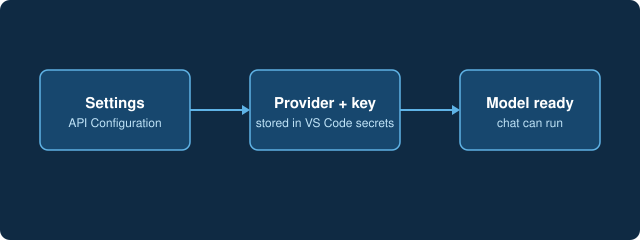

# Connect a model

AI-Hydro runs on a language model that you choose. Open **Settings**, pick a provider (Anthropic, OpenAI, Google, OpenRouter, DeepSeek, Ollama and others) and paste your API key. The key is kept in VS Code's secret storage on this machine.

[Open Settings](command:aihydro.settingsButtonClicked)
