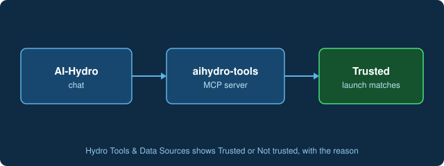

# Check that the AI-Hydro tools are ready

The hydrology tools (watershed delineation, streamflow, signatures, claims) come from the `aihydro-tools` MCP server. Open **Hydro Tools & Data Sources** and look at the server row. **Trusted** means the server was started with the launch line AI-Hydro recorded for it, so its instructions reach the model and claim approval is enabled. **Not trusted** gives the reason.

[Open Hydro Tools & Data Sources](command:aihydro.mcpButtonClicked)
