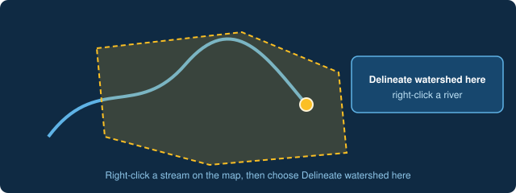

# Delineate a basin from the map

Open the **Map View**, right-click the stream at the outlet you care about and choose **Delineate watershed here**. AI-Hydro traces the basin upstream of that point and draws it on the map, and the result is saved to a study you can return to.

[Open the Map View](command:aihydro.mapButtonClicked)
