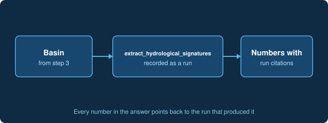

# Compute hydrologic signatures

With the basin on the map, ask in chat: "Compute the hydrologic signatures for this basin." AI-Hydro fetches the streamflow record, runs the signature tool and records the run. Numbers in the answer carry a citation to the run that produced them, and answers with numbers that have no recorded run are flagged.

[Start a new task](command:aihydro.plusButtonClicked)
