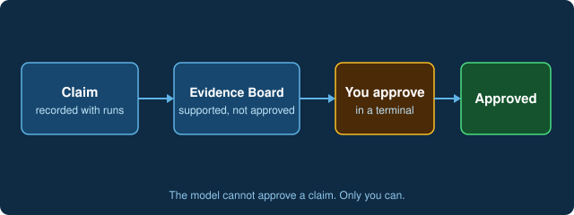

# Record a claim and approve it yourself

Ask AI-Hydro to record a claim, for example: "Record a claim about this basin's baseflow index, citing the signature run." The claim appears on the **Evidence Board** as supported but not approved. Approval is yours alone: the model cannot approve a claim. Use **Approve in terminal** and run the command it types for you.

[Open the Evidence Board](command:aihydro.evidenceBoardButtonClicked)
